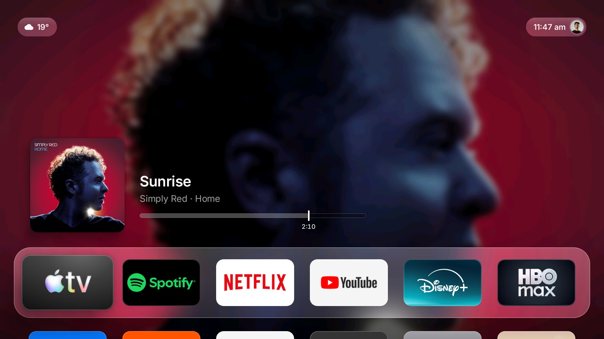
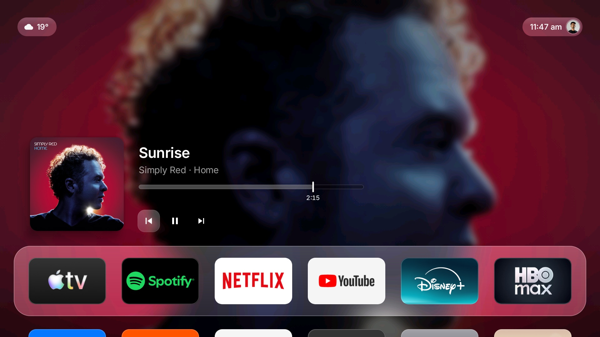
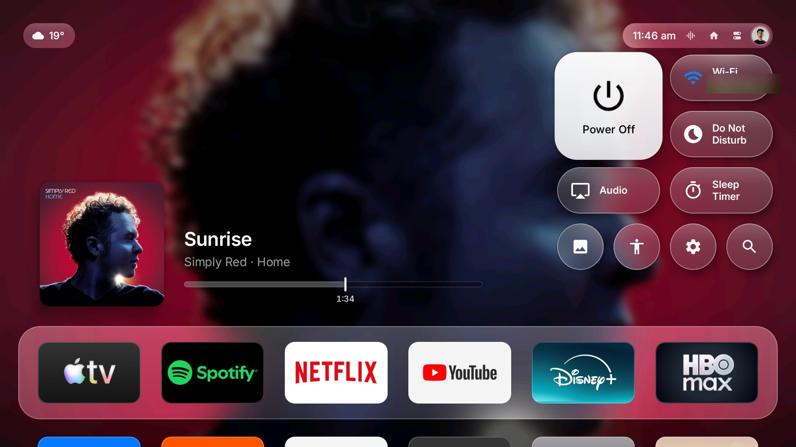
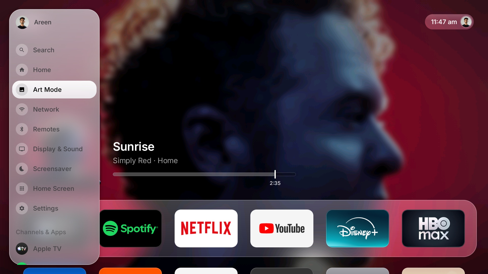
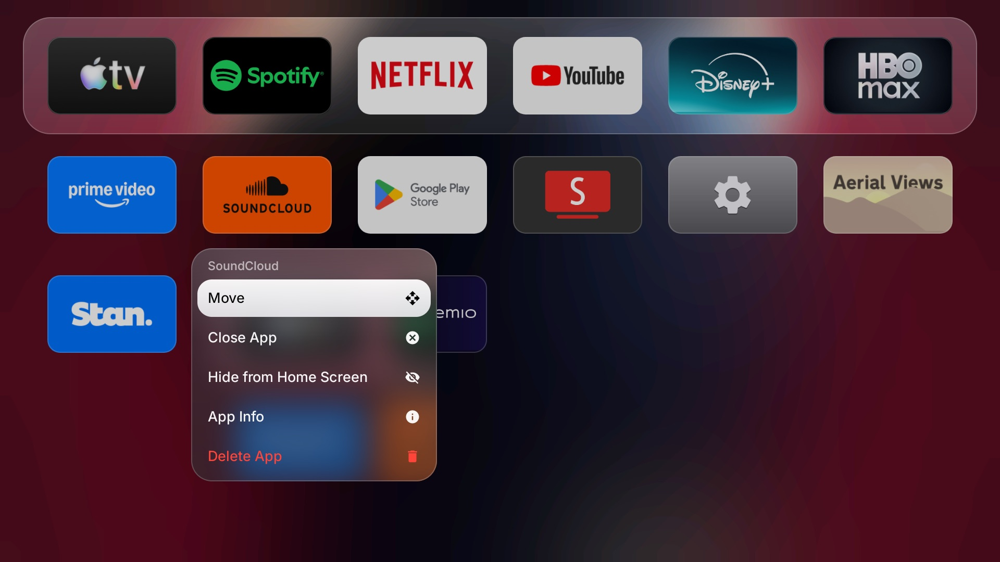
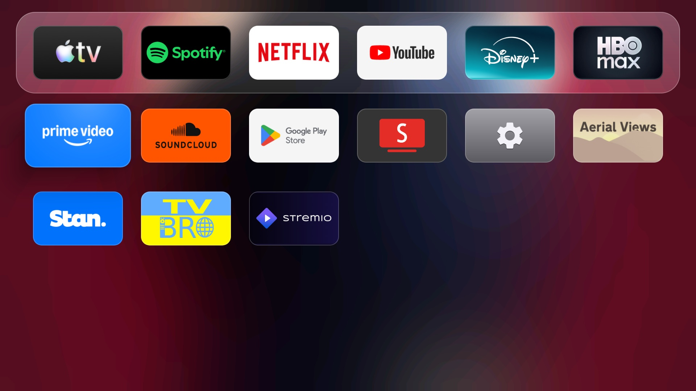
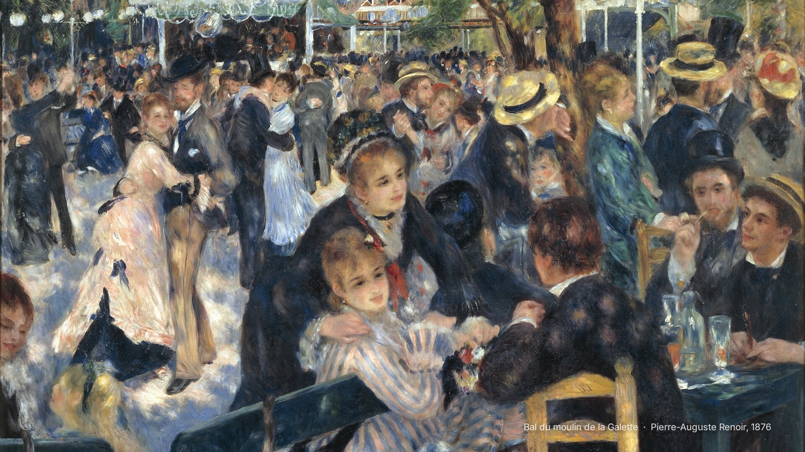

# TVOS — an Apple TV–style home screen for Google TV

**Halo Home** is a custom launcher I built for a Chromecast with Google TV (HD) to replace the stock,
ad-heavy Google TV home screen with a clean interface modelled on Apple's tvOS 26 "Liquid Glass"
design. It's written from scratch in plain Java with no third-party libraries (a ~70 KB APK),
built without Gradle, and deployed over wireless ADB together with a reversible debloat of the TV.



## Highlights

| | |
|---|---|
|  |  |
| **Now Playing** – the playing song's artwork becomes the backdrop; controls and the playhead time appear when focused and hide again after 5 s. | **Control Center** – tvOS 26 layout: floating glass Power Off, Wi-Fi, Do Not Disturb, Audio and Sleep Timer controls. |
|  |  |
| **Sidebar** – frosted panel with profile, system destinations and apps. | **App context menu** – Move, Close App, Hide, App Info, Delete. |
|  |  |
| **App grid** – six 5:3 icons per row with a frosted dock, matching tvOS spacing. | **Art Mode** – Frame TV–style full-screen public-domain paintings, also a screensaver. |

## Features

- **tvOS home screen layout.** Dock position, 5:3 icons, six columns and focus growth are measured
  from tvOS screenshots. The dock's padding and corner radius are derived so a focused icon sits an
  even distance from every edge, with concentric corners.
- **Liquid Glass materials.** The dock, panels and pills draw a blurred copy of what is behind them
  (positioned by the view's location on screen) with a tint, a top sheen and a hairline rim.
- **Focus effect** following Apple's HIG: the icon lifts, sways gently and its surface lights up
  with a soft glow that drifts with the sway.
- **Now Playing** using Android's media session API through a notification listener. Spotify-style
  artwork backdrop, a tvOS 26 scrubber with a playhead time, and controls that reveal on focus and
  auto-hide.
- **Control Center and top-right capsule.** The capsule shows the time, Home, Control Center and
  profile, plus audio and headphones buttons only while they're relevant. Includes a working sleep
  timer and Do Not Disturb.
- **Weather pill** (Open-Meteo, no account; location from the TV's time zone).
- **Sidebar** with an even, spec-matched header and soft translucent highlights.
- **App context menu** anchored beside the held icon, including a *Close App* action.
- **Art Mode** (activity + `DreamService`) with captions taken from file names.
- **Wallpapers.** Apple wallpapers converted from the Mac, or painted landscapes generated in code.
- **Debloat** of ads and telemetry packages, done per-user and fully reversible.

## Engineering notes

- **No Gradle.** [`halo/build.sh`](halo/build.sh) runs `aapt2 → javac → d8 → zipalign → apksigner`
  straight from the Android SDK build tools.
- **Performance on a low-end TV GPU.** Frames were taking ~110 ms. Turning layers on and off one at
  a time showed the cause: stretching a small blurred bitmap to full screen every frame. Pre-scaling
  backgrounds to exactly screen size (RGB_565), baking the scrim into the bitmap and removing
  overdraw brought it to **~24 ms**. Tile corners are baked into the artwork, so there's no
  per-frame outline clipping.
- **Artwork backdrops** are built off the main thread. The main backdrop appears in ~0.3 s and the
  frosted versions follow. Small placeholder covers are ignored, recent covers are cached, and
  stale jobs are skipped when tracks change quickly.
- **Replacing the stock launcher** needed more than disabling it. Google's setup app has a
  "recovery" Home activity that takes over Home, so `setupwraith` is disabled too (and restored by
  `restore.sh`).
- **Android limits** I designed around:
  - Launchers can't force-stop the most recently used app, so *Close App* falls back to the app's
    Force stop page.
  - Apps can't start the screensaver directly, so the shortcut opens screensaver settings instead.
  - Google Sans runs heavier than SF Pro, so font weights are scaled per typeface.
- **Typography.** Uses [Inter](https://rsms.me/inter/) (SIL OFL, closest open font to SF Pro)
  when it has been pushed to the TV, otherwise Google Sans Flex.

## Repository layout

```
halo/                    launcher source (Java, resources, manifest) + build.sh
debloat.sh / restore.sh  disable bloat & set Halo as home / put everything back
debloat-list.txt         packages disabled (reversible, per-user)
set-wallpaper.sh         push any image as the home-screen background
set-avatar.sh            push the profile picture
install-font.sh          push a .ttf (e.g. Inter) for the UI font
docs/screenshots/        screenshots from the TV
```

## Build & install

Requires the Android SDK command-line tools (platform 34, build-tools 34), JDK 17 and `adb`, with
wireless debugging paired to the TV.

```bash
cd halo && ./build.sh            # builds build/HaloHome.apk (creates a local signing key on first run)
adb install -r build/HaloHome.apk
./debloat.sh                     # set Halo as home and disable the bloat
./restore.sh                     # undo everything
```

## Credits

- Interface design inspired by Apple's tvOS. Not affiliated with Apple. No Apple fonts or code are
  included.
- Icons adapted from Google's Material Symbols (Apache 2.0).
- Inter by Rasmus Andersson (SIL Open Font License, see `halo/fonts/Inter-LICENSE.txt`).
- Weather from Open-Meteo. Art Mode paintings are public domain, from Wikimedia Commons (not
  included in the repo).
