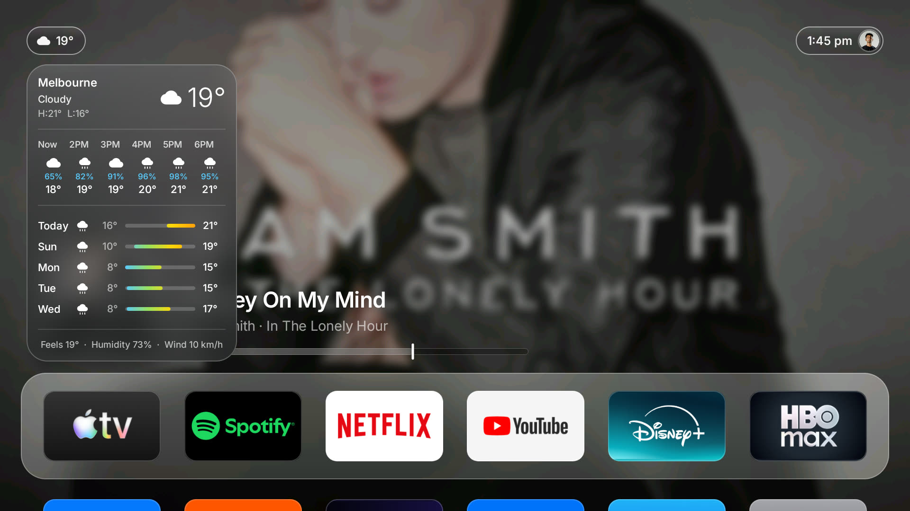
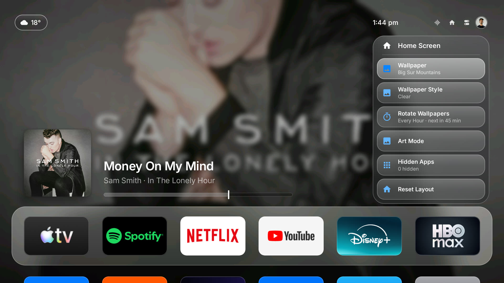

# Halo Home — an Apple TV-style home screen for Google TV

Halo Home is a custom launcher I designed and built from scratch for a **Chromecast with Google TV (HD)**.
It replaces the stock, ad-filled Google TV home screen with a clean interface modelled on Apple's
**tvOS 26 "Liquid Glass"** design, and ships with a reversible debloat so the TV feels fast.

It is plain Java with **no third-party libraries**, about **110 KB**, built **without Gradle**, and
installed over wireless ADB. No root and nothing on the TV is modified permanently: one script
puts everything back.


> Not affiliated with Apple. It follows tvOS's layout and motion; no Apple code, fonts or images
> are included in this repository.

## Contents

- [What it looks like](#what-it-looks-like)
- [Features](#features)
- [Install it on your own TV](#install-it-on-your-own-tv)
- [Everyday use](#everyday-use)
- [Customising](#customising)
- [Undo everything](#undo-everything)
- [Troubleshooting](#troubleshooting)
- [How it was built (portfolio write-up)](#how-it-was-built-portfolio-write-up)
- [Repository layout](#repository-layout)
- [Credits](#credits)

## What it looks like

| | |
|---|---|
|  |  |
| **Now Playing**: the song's artwork becomes the backdrop. Select the card for previous, play/pause, next and a dismiss ✕. | **Control Center**: Power Off, Wi-Fi, Do Not Disturb, Audio and Sleep Timer as floating glass. |
|  |  |
| **Weather**: open the pill for current conditions, the next six hours, five days with range bars and a details line. | **Home panel**: wallpaper, clear/soft style, timed rotation, Art Mode and hidden apps. |
|  |  |
| **Sidebar**: profile, system destinations and your first apps. | **App menu** (hold OK): Move, Close App, Hide, App Info, Delete. |
|  |  |
| **App grid**: six 5:3 icons per row on a frosted dock. | **Art Mode**: full-screen public-domain paintings, also usable as the screensaver. |

## Features

- **tvOS layout.** Six 5:3 icons per row on a frosted dock, with the dock position, spacing and
  focus growth (18%) measured from tvOS. A selected icon sits the same distance from every dock
  edge, with concentric corners.
- **Liquid Glass.** The dock, panels and top-bar pills draw a blurred copy of what is behind them,
  plus a tint, a top sheen and a hairline rim. Wallpapers can be shown sharp ("Clear") or blurred ("Soft").
- **Top bar.** Weather pill (top left) and a time/profile capsule (top right) that expands into
  Home, Control Center and, when relevant, audio and headphones buttons.
- **Control Center** in the tvOS 26 layout, with a working **sleep timer** and **Do Not Disturb**.
- **Weather.** The pill opens a forecast panel: current conditions, the next six hours with
  rain chance, five days with range bars, and feels-like, humidity and wind. Free data from
  [Open-Meteo](https://open-meteo.com), no account.
- **Now Playing.** Reads the active media session (Spotify, etc.). The playing track's artwork
  becomes the home backdrop; select the card for previous, play/pause, next, and a dismiss ✕.
  Music playing on another device can be brought onto the screen with **Show on Home Screen**.
- **Sidebar** with your photo and name, search, Home, Art Mode, network, display, screensaver
  and your first apps.
- **App context menu** beside the held icon, including **Close App**.
- **Art Mode**: full-screen artwork that rotates every few minutes, also usable as the
  screensaver. Captions come from file names ("Title - Artist, Year.jpg").
- **Wallpapers** from your own photos with optional timed **rotation** and a crossfade.
- **Motion that feels like tvOS.** Spring-based focus lift ("pull and land"), an elastic
  dock-to-apps scroll, springy panels, and a Control Center cascade.
- **Debloat** of ad and telemetry packages. Everything is reversible.

## Install it on your own TV

This was built and tested on a **Chromecast with Google TV (HD)** running **Android 14**. Other
Android TV / Google TV devices on Android 12 or newer (API 31+) should work, but are untested.

### 1. What you need on your computer

- `adb` (Android platform-tools)
- A **JDK 17**
- The Android SDK **platform 34** and **build-tools 34**

On a Mac with Homebrew:

```bash
brew install --cask android-platform-tools android-commandlinetools
brew install openjdk@17
sdkmanager --sdk_root=/opt/homebrew/share/android-commandlinetools "platforms;android-34" "build-tools;34.0.0"
```

On Linux or Windows install the same three things and set `ANDROID_SDK` to your SDK folder
(and `JAVA_HOME` if `java` is not JDK 17).

### 2. Turn on wireless debugging on the TV

1. **Settings → System → About**: press OK on **Android TV OS build** seven times to unlock
   Developer options.
2. **Settings → System → Developer options → Wireless debugging**: turn it on.
3. Your computer and the TV must be on the **same Wi-Fi network**.

### 3. Connect

Choose **Pair device with pairing code**. It shows an `IP:port` and a 6-digit code:

```bash
adb pair 192.168.1.50:37115        # use the pairing IP:port, then type the code
```

Back on the main Wireless debugging screen note the **other** `IP:port` and connect:

```bash
adb connect 192.168.1.50:40733
adb devices                         # should list the TV
```

(The connection port changes after a restart. Reconnect with the new one.)

### 4. Build and install Halo

```bash
git clone https://github.com/areenyapa1/TVOS.git
cd TVOS/halo
./build.sh                          # creates build/HaloHome.apk and a local signing key
adb install -r build/HaloHome.apk
```

Give Halo access to what is playing (for the Now Playing card) and, optionally, to Bluetooth
and Wi-Fi details for Control Center:

```bash
adb shell cmd notification allow_listener com.halo.tvhome/com.halo.tvhome.MediaListener
adb shell pm grant com.halo.tvhome android.permission.BLUETOOTH_CONNECT
adb shell pm grant com.halo.tvhome android.permission.ACCESS_FINE_LOCATION
```

### 5. Make it your home screen

Read `debloat-list.txt` first. It is the list of packages that will be disabled, and you can delete
any line you want to keep. Then:

```bash
cd ..
./debloat.sh
```

This sets Halo as Home, disables the listed packages **for your user only** (nothing is
uninstalled), and speeds up animations. It also disables Google's setup app, because its recovery
screen otherwise takes over the Home button.

### 6. Optional extras

```bash
./set-wallpaper.sh ~/Pictures/photo.jpg        # add a wallpaper (resized to 1920x1080 JPEG)
./set-avatar.sh ~/Pictures/me.png              # profile picture
./install-font.sh path/to/Font.ttf             # UI font (Inter works well)
./set-icon.sh com.android.vending tile.png     # replace any app's tile (5:3 image)
```

Art Mode shows the pictures in `files/art/` on the TV (and falls back to your wallpapers):

```bash
adb shell mkdir -p /sdcard/Android/data/com.halo.tvhome/files/art
adb push "Starry Night - Vincent van Gogh, 1889.jpg" /sdcard/Android/data/com.halo.tvhome/files/art/
```

To use Aerial Views (Apple-style flyovers) as the screensaver, install it from its
[releases page](https://github.com/theothernt/AerialViews/releases) and run:

```bash
adb shell settings put secure screensaver_components com.neilturner.aerialviews/.ui.screensaver.DreamActivity
```

## Everyday use

| Do this | To get this |
|---|---|
| Arrow keys | Move focus; the dock and apps scroll with a spring |
| **OK** on an app | Open it |
| **Hold OK** on an app | Menu: Move, Close App, Hide, App Info, Delete |
| **Left** from the first column | Sidebar |
| **Up** from the dock | Top bar: Home panel (wallpaper, style, rotation, Art Mode), Control Center, profile |
| **Up** from the left half | The weather pill (press OK for the forecast) |
| Sound-wave button (while music plays) | Playback and volume panel, plus **Show on Home Screen** |
| ✕ on the music card | Hide it until the music changes |
| **Back** | Close the open panel or return to the top of the home screen |
| **Home** | Back to the top, from anywhere |

## Customising

- **Wallpaper style.** Home panel → *Wallpaper Style*: **Clear** keeps the photo sharp behind the
  glass (the tvOS 26 look), **Soft** blurs it.
- **Rotation.** Home panel → *Rotate Wallpapers*: off, 15 minutes, hourly or daily.
- **Weather location.** It uses the city from your TV's time zone (e.g. `Australia/Melbourne` → Melbourne).
- **Profile name.** Defaults to the first name in `HomeActivity.profileName()`.

## Undo everything

```bash
./restore.sh                        # re-enables every package, restores animations and the Google TV home
adb uninstall com.halo.tvhome       # optional: remove Halo itself
```

Disabling is per-user and reversible, so no factory reset is ever needed.

## Troubleshooting

| Problem | Fix |
|---|---|
| `adb devices` shows nothing | The wireless port changed. Re-open Wireless debugging and `adb connect` the new `IP:port`. |
| Home button opens a "setup" screen | `./debloat.sh` disables the setup app. Re-run it, or `adb shell cmd package set-home-activity com.halo.tvhome/.HomeActivity`. |
| No music card | Grant notification access (step 4). If music plays on another device, use *Show on Home Screen*. |
| Sideloaded apps missing | Halo lists apps with a TV (leanback) launcher, and phone apps that have a launcher entry. Pull the list with `adb shell pm list packages -3`. |
| Build says `Missing …/aapt2` | Set `ANDROID_SDK` to the folder containing `build-tools/34.0.0`. |
| Something looks wrong | `./restore.sh` returns the TV to stock. |

## How it was built (portfolio write-up)

**The goal.** Make a Google TV feel like an Apple TV: clean, calm, no ads, with Apple's
spacing, glass material and motion. The TV in question is weak (1.4 GB RAM, a modest GPU), so
performance mattered as much as looks.

**Approach.** I started with research and measurement rather than guessing. I measured the dock
position, icon size, focus growth and padding from tvOS screenshots, turned them into constants,
and derived the rest from them. For example, side padding is calculated so a focused icon sits an
even distance from every dock edge, and the dock's corner radius is that icon's corner radius plus
the gap, so the curves are concentric. I iterated against screenshots taken from the TV itself
over ADB after every change.

**Problems I had to solve**

- **Replacing the stock launcher.** Disabling Google's launcher was not enough: the setup wizard
  registers a "recovery" Home activity that took over the Home button. Android also forbids
  disabling a single component from the shell, so I disabled the setup package and added it to
  the reversible list.
- **Performance on a low-end GPU.** Home-screen frames took ~110 ms. I found the cause by hiding
  one layer at a time and measuring `dumpsys gfxinfo`: stretching a small blurred bitmap to full
  screen every frame was costing ~80 ms. Pre-scaling backgrounds to the exact screen size, baking
  the legibility gradient into the bitmap and baking tile corners into the artwork brought it to
  **~22 ms (about 45 fps)**.
- **Lag from an endless animation.** A gentle looping "sway" on the selected icon kept the GPU
  redrawing ~63 times a second even when nothing happened, so remote presses queued behind it.
  Removing it dropped idle redraws from 190 per 3 seconds to 6.
- **Liquid Glass without a blur API.** Each glass surface draws a pre-blurred snapshot of the
  screen at its own position (the shader is offset by the view's on-screen location), then a
  tint, a sheen and a rim. Pills use the sharp backdrop ("clear" glass) and panels use the blurred
  one.
- **Now Playing.** Built on the media-session API through a notification listener. Spotify's TV
  app sometimes labels local playback "remote", so the card hides only when the session is remote
  *and* the TV is silent. Cover art is built off the main thread: the backdrop appears in ~0.3 s
  and the frosted versions follow; Spotify's small placeholder cover is ignored, recent covers are
  cached, and stale jobs are skipped when tracks change quickly. A once-a-second check catches
  track changes that a backgrounded app never announces.
- **Motion.** `Spring` is a damped-spring `TimeInterpolator` with an initial velocity. Without
  that velocity a spring starts from rest and the first frames look like a delay, so focus
  changes felt laggy until I added it. Each kind of movement has its own spring.
- **Android's limits, designed around.** Launchers can't force-stop the most recent app (Close
  App falls back to its Force Stop page), apps can't start the screensaver directly, and Google
  Sans runs heavier than SF Pro (so font weights are scaled per typeface).
- **No Gradle.** [`halo/build.sh`](halo/build.sh) is the whole build:
  `aapt2 → javac → d8 → zipalign → apksigner`. It works on a laptop with only the SDK
  command-line tools.

**What this shows.** Android UI work without a framework, performance profiling on constrained
hardware, a design system translated from reference measurements, media and system APIs, and
careful reversibility (every change is scripted and undoable).

## Repository layout

```
halo/                      launcher source (Java, resources, manifest) + build.sh
  src/com/halo/tvhome/     HomeActivity, GridPanel, AppTile, Dropdown, Sidebar, NowPlayingCard,
                           WeatherPanel, ControlBar, ArtFrameView, Spring, FrostDrawable, ...
debloat.sh / restore.sh    disable the bloat and set Halo as home / put everything back
debloat-list.txt           packages disabled (per-user, reversible)
set-wallpaper.sh           push an image as a wallpaper
set-avatar.sh              push your profile picture
set-icon.sh                replace one app's tile image
install-font.sh            push a .ttf as the UI font
docs/screenshots/          screenshots from the TV
```

## Credits

- Interface design inspired by Apple's tvOS. Apple fonts, icons and wallpapers are **not** included.
- Icons adapted from Google's Material Symbols (Apache 2.0).
- [Inter](https://rsms.me/inter/) by Rasmus Andersson (SIL Open Font License, `halo/fonts/Inter-LICENSE.txt`).
- Weather from [Open-Meteo](https://open-meteo.com). Art Mode paintings are public-domain works
  from Wikimedia Commons and are not included in the repo.
